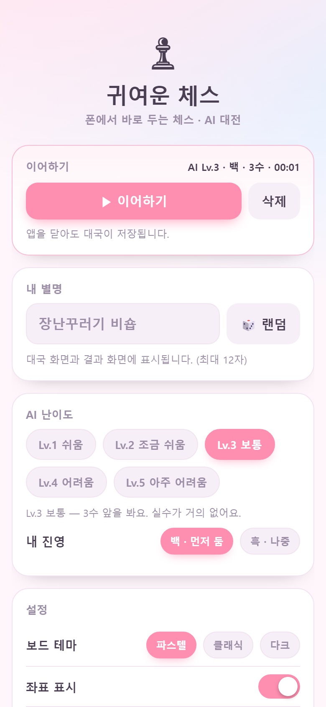
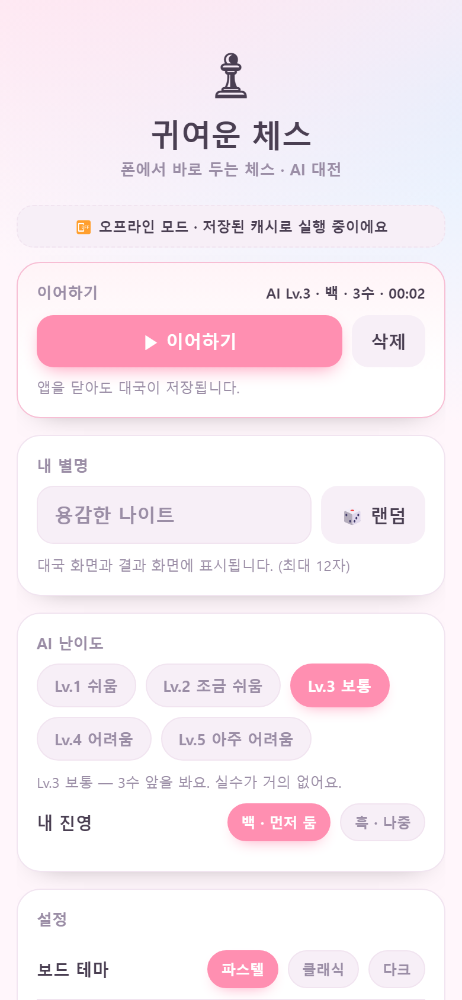
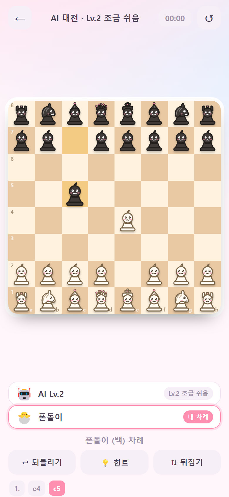
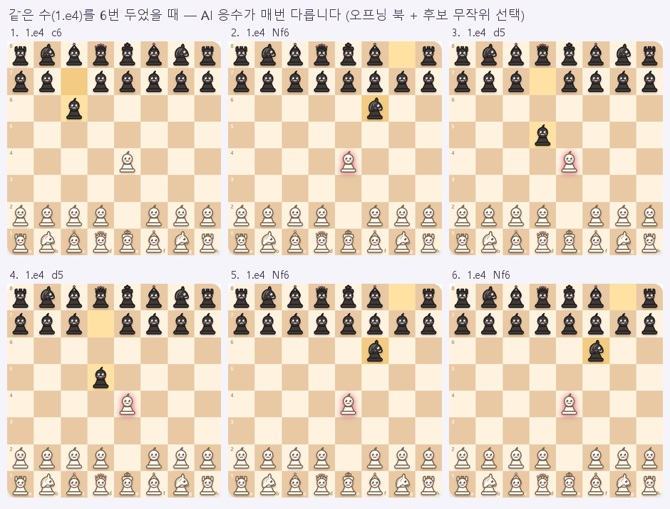

# ♟ 귀여운 체스

안드로이드(및 모든 모바일 브라우저)에서 실행되는 **모바일 웹 체스 게임**.
설치 없이 브라우저에서 바로 열리고, 별명을 넣고 **AI와 대국**할 수 있습니다.

> 기획서: [`기획서.md`](기획서.md)

---

## 지금 상태 : 5주차 — AI 응수 다양성까지 (MVP + 다듬기)

| 주차 | 내용 | 상태 |
|---|---|---|
| 1주차 | 보드 렌더링 · 기물 배치 · 터치 조작(탭/드래그) · 별명 · 설정 저장 · 귀여운 기물 SVG | ✅ 완료 |
| 2주차 | 정식 규칙 · 대수 표기법 · 힌트 · 프로모션 · 결과 화면 · 가로 화면 | ✅ 완료 |
| 3주차 | AI 대전 (Web Worker · 난이도 5단계) · 진영 선택 · 승/패 결과 · 쌍 되돌리기 · 검색 최적화 | ✅ 완료 |
| 4주차 | 대국 자동 저장/이어하기 · 효과음(WebAudio) · PWA(오프라인 · 홈 화면 추가) + 종합 테스트 122개 | ✅ 완료 |
| **5주차** | **AI 응수 다양성 — 같은 국면에서 매번 같은 수만 두지 않게 (오프닝 북 + 후보 무작위 선택)** | ✅ **완료** |
| 배포 | **GitHub Pages 배포 (HTTPS)** — 폰에서 홈 화면에 추가해 앱처럼 실행 가능 | ✅ **완료** |
| 다음 | 실기기(안드로이드) 테스트 · 기보 보관함(PGN) · AI 코멘트 · Stockfish 옵션 | ⬜ 예정 |

### 🔗 지금 바로 열어볼 수 있습니다

**<https://javacoffeemoo-rgb.github.io/cute-chess/>**

폰에서 이 주소를 열고 → 브라우저 메뉴 → **홈 화면에 추가** → 인터넷이 없어도 앱처럼 실행됩니다.
(올린 직후 `dev/verify_deploy.py` 로 **실제 주소를 15개 항목 검사 → 전부 통과**)

  

*4주차 화면 — 이어하기 카드 · 오프라인 안내 · **비행기 모드에서도 AI 대전***
(전체 6컷: `dev/week4-preview.png` · 3주차 10컷: `dev/week3-preview.png`)

---

## 실행 방법

```powershell
cd chess-game
python serve.py            # http://localhost:8123
```

같은 Wi-Fi의 폰에서 **`http://<PC의 IP>:8123`** 로 접속합니다 (serve.py 가 주소를 출력합니다).
Windows 방화벽이 막으면 파이썬에 대해 허용 규칙을 한 번 추가해 주세요.

> **`python -m http.server` 대신 `serve.py` 를 쓰는 이유**
> Windows 레지스트리에는 `.js` 가 `text/plain` 으로 등록된 경우가 많고, 파이썬 기본 서버는 그 값을 그대로 씁니다.
> `<script src>` 는 그래도 동작하지만, **Web Worker 는 MIME 타입을 반드시 검사하기 때문에**
> `new Worker('engine/ai-worker.js')` 가 실패합니다. 그러면 AI가 메인 스레드 폴백으로 돌아가
> **생각하는 동안 화면이 얼어붙습니다.** `serve.py` 는 `.js` 를 `text/javascript` 로 보내 이 문제를 없앱니다.

`file://` 로 직접 열어도 게임은 동작하지만, 이 경우에도 Worker 가 막혀 폴백으로 돌아갑니다
(게임은 정상, 다만 Lv.4~5 에서 잠깐 멈칫할 수 있습니다).

> **PWA(오프라인 · 홈 화면 추가)는 `http(s)` 에서만 동작합니다.**
> 브라우저가 보안상 `file://` 에서는 서비스 워커를 막습니다.
> 폰에서 주소를 열고 크롬 메뉴의 **홈 화면에 추가**를 누르면 앱처럼 실행되고, 한 번 열어 둔 뒤에는
> **인터넷이 끊겨도(비행기 모드) 그대로 플레이할 수 있습니다** (규칙·AI 엔진이 전부 기기에 있기 때문).
> PC에서 주소만 있으면 설치는 안 되지만 오프라인 실행은 `http://localhost:8123` 에서도 확인할 수 있습니다.
>
> ⚠️ **폰에서 `http://<PC의 IP>:8123` 로 열면 PWA 기능은 동작하지 않습니다.**
> 서비스 워커/설치 프롬프트는 **보안 컨텍스트(https 또는 localhost)** 에서만 허용됩니다.
> 게임 자체(AI 대전·저장)는 그대로 잘 되고, **설치·오프라인만** 안 됩니다.
> 폰에서 PWA 까지 확인하려면
> ① `ngrok http 8123` 같은 https 터널을 쓰거나 ② GitHub Pages/Cloudflare Pages 에 올리거나
> ③ 폰 크롬의 `chrome://flags` → *Insecure origins treated as secure* 에 `http://<PC의 IP>:8123` 를 추가하세요.

---

## 조작 방법

| 동작 | 방법 |
|---|---|
| 기물 선택 | 기물을 **탭** (합법 칸에 점이 표시됨) |
| 이동 | 표시된 칸을 **탭** |
| 이동 (드래그) | 기물을 **끌어서** 원하는 칸에 놓기 |
| 선택 취소 | 같은 기물을 다시 탭 / 빈 칸 탭 |
| 되돌리기 | 하단 `↩ 되돌리기` — **내 수 + AI 수를 한 쌍으로** 되돌립니다 |
| 힌트 | 하단 `💡 힌트` (다시 누르면 꺼짐 · 내 차례에만) |
| 판 뒤집기 | 하단 `⇅ 뒤집기` |
| 프로모션 | 폰을 끝줄로 옮기면 기물 선택 팝업 |
| 이어하기 | 홈의 **이어하기 카드** → `▶ 이어하기` (앱을 닫아도 대국이 남아 있음) |
| 소리 · 진동 | 홈 → 설정에서 켜고 끄기 (설정은 자동 저장) |

AI가 생각하는 동안에는 보드 입력 · 되돌리기 · 힌트가 잠기고, 상대 표시가 **`생각 중…`** 으로 깜빡입니다.

---

## 파일 구조

```
chess-game/
  index.html              진입점 (홈 / 대국 두 화면 + 프로모션·결과 팝업)
  style.css               레이아웃 + 3가지 테마 + 가로 화면 대응
  pieces.js               귀여운 기물 SVG 12종 (자체 제작)
  app.js                  게임 상태 · 렌더링 · 터치 조작 · AI 연동 · 저장/이어하기 · 효과음
  serve.py                개발 서버 (MIME 타입을 바로잡은 http.server)
  manifest.webmanifest    ★ PWA 앱 정보 (이름 · 아이콘 · 테마색 · 세로 고정)
  sw.js                   ★ 서비스 워커 (오프라인 캐시)
  icons/                  ★ 앱 아이콘 (아이콘도 귀여운 킹 — dev/icon.html 에서 캡처)
    icon-192.png · icon-512.png · icon-maskable-512.png · apple-touch-icon.png
  engine/
    rules.js              ★ 체스 규칙 엔진 (자체 구현, perft 로 검증)
    search.js             ★ 수 찾기 엔진 (미니맥스 + 알파베타 + 난이도 정책)
    ai-worker.js          ★ AI 두뇌 (Web Worker — 화면이 얼지 않게)
  dist/                   ★ 배포용 사본 (make_dist.py 가 만든다 — 이 폴더를 올리면 끝)
  기획서.md               기획서
  README.md               이 파일
  dev/
    perft.html            규칙 정확성 검증 (표준 perft 기준값 대조)
    piece-sheet.html      기물 확인 시트
    icon.html             앱 아이콘 소스 (기물 SVG 를 그대로 사용)
    render_sheet.py       기물 SVG → PNG 변환
    make_icons.py         앱 아이콘 PNG 생성 (playwright)
    shots.py              실제 크롬으로 화면 캡처 (playwright)
    test_all.py           ★ 종합 테스트 127개 (기기 프로필·터치·스로틀·오프라인·다양성)
    verify_week4.py       4주차 검증 (재실행 이어하기 · 오프라인) + 캡처
    engine-spread.py      국면의 루트 수 점수표 (난이도·후보 폭 튜닝용)
    make_variety.py       ★ 5주차 증거 이미지 (같은 수 → 다른 응수)
    make_dist.py          ★ 배포용 폴더(dist/) 만들기 + 경로 검사
    verify_deploy.py      ★ 배포 검증 (하위 경로 · PWA · Worker AI · 오프라인)
    make_preview.py       화면 모음(contact sheet) 만들기
    shot-*.png            대국 화면 캡처 10컷
    shot4-*.png           4주차 화면 캡처 6컷
    var-*.png             5주차 — 1.e4 에 대한 AI 응수 6컷
    week3-preview.png     화면 모음 (3주차)
    week4-preview.png     화면 모음 (4주차)
    week5-preview.png     화면 모음 (5주차 — 응수 다양성)
```

---

## 5주차에서 한 일 — AI 응수 다양성



*같은 수(1.e4)를 6번 두었을 때 — AI 응수가 매번 다릅니다 (`dev/make_variety.py`)*

**문제**: 탐색이 완전히 결정적이라 **같은 국면에서는 AI 가 매번 똑같은 수**를 뒀습니다.
("3수까지 똑같이 두고, 내가 같은 실수를 하면 계속 같은 게임" → 두 번째 판이 지루함)

**해결 (두 가지)**

1. **오프닝 북** — 첫 수와 그에 대한 첫 응수만 정석 중에서 고릅니다 (`engine/search.js` 의 `BOOK`).
   - 백 첫 수 8가지(e4 · d4 · Nf3 · c4 · e3 · d3 · Nc3 · g3), 1.e4 에 대한 흑 응수 7가지(e5 · c5 · e6 · c6 · d5 · Nf6 · d6) …
   - 국면(보드 + 차례)이 **정확히 일치할 때만** 쓰고, 합법수가 아니면 그냥 무시하고 탐색으로 넘어갑니다.
   - 이 엔진의 평가는 중앙 폰 가치를 낮게 보는 편이라, 북이 없으면 첫 수로 a4 같은 수가 나올 수 있습니다.

2. **후보 무작위 선택 (핵심)** — 탐색이 끝난 뒤
   - 마지막으로 완료한 깊이의 **모든 루트 수**를 "최선수와 ±variety 센티폰" 안에서 모으고,
   - 후보를 전체 창(full window)으로 다시 탐색해 **정확한 점수**로 확인한 뒤,
   - 그중 하나를 **무작위로** 고릅니다.

```
후보 폭(센티폰)  Lv.1 60 · Lv.2 40 · Lv.3 25 · Lv.4 15 · Lv.5 10   (초반 기물 28개 이상이면 20)
고르는 순서      "말이 되는 수" 등급 우선(프로모션 > 캐슬링 > 잡기 > 전개·중앙 폰) → 같은 등급 안에서 무작위
```

**실력은 그대로 유지했습니다** — 점수 차가 후보 폭을 넘으면 애초에 후보에 들지 않으므로
손실의 상한이 곧 후보 폭입니다(실측: Lv.4 중반에서 최대 12cp = 0.12폰).
전술 테스트도 **Lv.4 20/20 · Lv.5 20/20** 그대로 통과합니다.

**3회 반복(무승부) 회피** — 되돌아가는 수에 주는 벌점을 25 → **40cp** 로 올렸습니다.
후보 폭(10~25)보다 커야 실제로 걸러지기 때문입니다.

**측정값** (`dev/test_all.py` 3번 구역 · `dev/engine-spread.py`)

| 항목 | 결과 |
|---|---|
| 오프닝 북 — 백 첫 수 16회 | **8가지** (e4·d4·Nf3·c4·e3·d3·Nc3·g3) |
| 1.e4 에 대한 흑 응수 16회 | **7가지** (e5·c5·e6·c6·d5·Nf6·d6) |
| 같은 중반 국면 15회 (Lv.3) | **3가지** (Be3 · Bd2 · Re1) |
| 북 없는 초반 12회 (Lv.4 / Lv.5) | **4가지** (Nc6 · Nd7 · Bd7 · c6) |
| 같은 국면 · 최선수 대비 손실 (Lv.4) | 최대 **12cp** |
| 반복되는 수 선택 (벌점 없음 → 있음) | 10/10 → **0/10** |

계산 시간은 Lv.5 에서 2.0초 → 약 2.3초로 늘었습니다(후보 확인 예산 +350ms).
그만큼 더 깊이 보므로(4수 → 5수 · 약 29만 국면) 세기는 오히려 올라갑니다.

상대 진영 배지에 마우스를 올리면(툴팁) `5수까지 탐색 · 299,008국면 · 2312ms · 후보 3가지`,
북에서 고른 수면 `오프닝 북에서 골랐어요 · 후보 7가지` 로 표시됩니다.

---

## 4주차에서 한 일

### 1) 대국 자동 저장 / 이어하기

**FEN 만 저장하면 안 되는 이유**: FEN 에는 "둔 수 목록"이 없어서 기보(1. e4 Nc6 …)가 사라지고,
3회 반복(무승부) 판정에 쓰는 국면 기록도 함께 사라집니다.
그래서 **둔 수 목록을 저장하고, 이어할 때 처음부터 다시 둡니다(리플레이)**.

```
저장  { v:1, moves:[{from:'e2',to:'e4'}, …], level, playerColor, elapsed, savedAt }
복원  rules.reset() → 저장된 수를 순서대로 rules.move() → 기보·캐슬링 권리·앙파상·반복 판정까지 그대로
```

- **매 수마다** 저장하고, 홈으로 나갈 때 · 앱이 백그라운드로 갈 때(`visibilitychange`)도 저장합니다
- 대국이 **끝나면 저장을 지웁니다**(끝난 판을 이어할 필요는 없으니까)
- 홈에는 **이어하기 카드**가 뜹니다 — `AI Lv.3 · 백 · 3수 · 00:00` 처럼 요약해서 보여주고 `▶ 이어하기` / `삭제`
- 저장이 깨져 있으면(수동 편집 등) 조용히 버리고 새 판을 시작합니다 → **게임이 죽지 않습니다**
- 되돌리기를 하면 저장된 목록도 같이 줄어듭니다(복원했을 때 화면과 저장이 어긋나지 않게)

### 2) 효과음 — 외부 파일 없이 WebAudio 로 직접 합성

음원 파일(mp3/wav)을 두지 않고 **오실레이터로 그때그때 만들어** 냅니다.

| 소리 | 소리 구성 |
|---|---|
| 이동 | 삼각파 560Hz, 85ms (짧은 "톡") |
| 잡기 | 사각파 320Hz + 사인파 180Hz (묵직한 "툭") |
| 캐슬링 | 440 → 620Hz 두 음 ("톡톡") |
| 체크 | 880 → 1180Hz 두 음 (경고) |
| 승리 / 패배 / 무승부 | 4음 상승 / 3음 하강 / 같은 음 2번 |
| 되돌리기 | 400 → 290Hz 하강 |

- 외부 파일이 없으니 **오프라인에서도 소리가 나고**, 용량도 0, 저작권 문제도 없습니다
- 모바일은 사용자 동작 없이 소리를 못 냅니다 → **첫 터치에서 AudioContext 를 깨웁니다**(`resume()`)
- 설정에서 끄면 `AudioContext` 를 아예 만들지 않습니다

### 3) PWA — 오프라인 실행 + 홈 화면에 추가

- `manifest.webmanifest` : 이름 · 아이콘 · 테마색 · **세로 고정(portrait)** · standalone
- 아이콘도 직접 만들었습니다 — `dev/icon.html` 에 **게임과 똑같은 기물 SVG** 를 띄우고
  크롬으로 캡처(`dev/make_icons.py`)해서 4종 생성 (192 / 512 / maskable / apple-touch)
- `sw.js` 캐시 전략
  | 대상 | 전략 | 이유 |
  |---|---|---|
  | 화면 이동(navigate) | **네트워크 우선** → 실패 시 캐시 | 온라인이면 항상 최신, 오프라인이면 저장본 |
  | 그 밖의 파일 | **캐시 먼저** → 뒤에서 갱신 | 두 번째 실행부터 즉시 뜸 |
- 캐시 키에서 `?t=123` 같은 쿼리를 떼어내 개발 중 캐시가 쌓이지 않게 했습니다
- 엔진·AI 가 전부 기기에 있으므로 **비행기 모드에서도 AI 대전이 그대로 됩니다** (실제로 검증)
- `beforeinstallprompt` 가 오면 홈에 **`📲 홈 화면에 추가`** 버튼을 보여줍니다
  (이미 설치돼 있거나 iOS 사파리면 안 뜹니다 — 대신 공유 → 홈 화면에 추가)

### 4) 검증 — `dev/verify_week4.py`

3주차와 달리 **진짜로 브라우저를 다시 열어서** 확인했습니다.

- 서비스 워커가 페이지를 제어하고 앱 껍데기 **11개 파일**을 캐시했는가
- 수를 둔 뒤 **`page.reload()`(진짜 재실행)** → 이어하기 카드가 뜨고 → 이어하면 기보가 한 수까지 그대로인가
- 오프라인(`context.set_offline(True)`)으로 새로고침 → 화면이 뜨고 · 이어하기가 남아 있고 · **AI 가 응수하는가**
- 소리 토글이 저장되는가 · 끝난 대국은 저장에서 지워지는가 · 깨진 저장은 버려지는가

### 5) 종합 테스트 — `dev/test_all.py` (실기기 대신 최대한 가깝게)

실기기(안드로이드)를 붙일 수 없는 환경이라, **실제 기기 프로필 9종 + 진짜 터치 이벤트 + CPU 스로틀**로 검증했습니다.
**127개 검사 · 3회 연속 전부 통과** (약 60초).

| 구역 | 내용 | 결과 |
|---|---|---|
| 1 | 기기 프로필 9종(픽셀·갤럭시·아이폰·가로) 레이아웃·칸 크기·가로 스크롤 | 45/45 |
| 2 | **CDP 진짜 터치**(touchStart/Move/End)로 탭-탭·드래그·선택 해제 | 9/9 |
| 3 | perft 23케이스 · 전술 Lv.4·5 40/40 · 합법수 퍼즈 · 무승부 3종 · 프로모션 · **응수 다양성 4종** | 13/13 |
| 4 | 동시 입력 잠금 · 생각 중 새 게임 취소 · 되돌리기 연타 · 프로모션 4종/취소 · 결과 문구 · 시계 · 접근성 | 26/26 |
| 5 | 저장 견고성 — 손상 데이터 6종 · 반복 이어하기 · 흑 진영 이어하기 | 15/15 |
| 6 | PWA 설치 요건(매니페스트·아이콘) · 오프라인 새로고침 · 오프라인 AI 대전 | 12/12 |
| 7 | **CPU 4배 스로틀**(중급 폰 흉내) 성능 · 메모리 | 7/7 |

측정값 (기기별 보드·칸 크기):

| 기기 | 화면 | 보드 | 칸 |
|---|---|---|---|
| 픽셀 5 | 390×844 | 365 | 45.6px |
| 픽셀 4a 5G / 넥서스 5X | 412×765 | 384 | 48.0px |
| 갤럭시 S9+ | **320×658** | 292 | 36.5px |
| 아이폰 SE | **320×568** | 272 | 34.0px |
| 픽셀 5 가로 | 844×390 | 215 | 26.9px |

**테스트가 실제로 잡아낸 버그 2개 (고침)**

1. **Web Worker 가 탐색 깊이·국면 수를 보내지 않았다** — `engine/ai-worker.js` 의 `postMessage` 에
   `depth`/`nodes` 가 빠져 있어서, AI 차례 뒤 상대 표시의 툴팁이 `undefined수까지 탐색` 으로 나왔습니다.
   (게임 진행에는 영향이 없어 눈치채기 어려운 버그 — Worker 경로에서만 발생)
   → 이제 `5수까지 탐색 · 299,008국면 · 2312ms · 후보 3가지` 처럼 정상 표시됩니다.
2. **아주 짧은 화면에서 칸이 28px 까지 작아졌다** — 아이폰 SE(568px 높이)에서 칸이 28.5px 로
   손가락으로 누르기 어려웠습니다. → 세로 화면에서 보드 최소 높이를 주고(칸 34px 보장),
   넘치는 부분은 화면 스크롤로 볼 수 있게 했습니다.

CPU 4배 스로틀(중급 폰 흉내) 결과 — **난이도 역전 없음**:

| 난이도 | 도달 깊이 | 시간 | 탐색 국면 |
|---|---|---|---|
| Lv.3 | 3수 | 262ms | 2,008 |
| Lv.4 | 4수 | 215ms | 15,633 |
| **Lv.5** | **5수** | 2312ms | **299,008** |

계산 중에도 배지가 `생각 중…` 으로 살아 있고(메인 스레드가 멈추지 않음), 새 게임 20회 후 힙 증가는 +0.0MB 였습니다.

> 검증 스크립트 자체의 flaky 문제도 2건 고쳤습니다 — 보드가 다시 그려지는 순간과 겹치면 좌표를 못 찾는 문제(재시도 추가),
> 그리고 Lv.3 의 6% 실수 때문에 "AI 승리" 장면이 가끔 안 나오던 문제(`shots.py` 에 재시도 추가).

---

## 3주차에서 한 일

### 1) AI 대전 — `engine/ai-worker.js` + `engine/search.js`

**왜 Web Worker 인가**: Lv.4~5는 1~2초를 생각합니다. 메인 스레드에서 돌리면 그동안 화면이
완전히 얼어붙어(입력·애니메이션 정지) 폰에서는 "앱이 멈춘 것"처럼 보입니다.
Worker로 분리하면 화면은 살아 있고, **생각 중** 표시와 함께 입력만 잠급니다.

```
앱 →  { type:'search', id, fen, level, repeats }
   ←  { type:'move',  id, move, depth, nodes, ms }
```

- 요청마다 **번호(id)** 를 붙여, 되돌리기·새 게임 후 도착한 **늦은 응답은 버립니다**
- Worker 를 못 쓰는 환경(`file://` 등)이면 **메인 스레드 자동 폴백**으로 게임은 계속됩니다
- 3회 반복으로 흘러가지 않도록, 이미 나온 국면 키 48개를 함께 보내 **회피 벌점**을 줍니다

### 2) 난이도 5단계

| 난이도 | 최대 깊이 | 최소 깊이 | 실수 확률 | 시간 제한 | 체감 |
|---|---|---|---|---|---|
| Lv.1 쉬움 | 1수 | 1 | **50%** | — | 절반은 엉뚱한 수 (체스 처음 배울 때) |
| Lv.2 조금 쉬움 | 2수 | 2 | 22% | — | 가끔 실수 |
| Lv.3 보통 | 3수 | 3 | 6% | — | 실수가 거의 없음 |
| Lv.4 어려움 | 4수 | 4 | 0% | 1.5초 | 기물 교환을 정확히 계산 |
| Lv.5 아주 어려움 | 6수 | 4 | 0% | 2.0초 | 남은 시간만큼 더 깊이 (보통 5~6수) |

- **최소 깊이(minDepth)** 를 둔 이유: 시간 제한으로 반복 심화가 잘려도 최소 깊이는 반드시 채웁니다.
  → **느린 폰에서도 Lv.5 가 Lv.4 보다 얕아지지 않습니다** (난이도가 뒤집히지 않음)
- **실수(blunder)** 는 "최선수를 모르고 다른 수를 두는" 방식이라, 단순히 약하게 만드는 게 아니라
  **진짜 실력 차이**가 납니다. Lv.1은 실제로 공짜 퀸을 놓치기도 합니다
- 남은 시간이 다음 깊이를 끝낼 가망이 없으면 **시작조차 하지 않습니다**(깊이당 2배 이상 느려지므로)

같은 국면에서 측정한 실제 값(데스크톱 Chromium):

| 난이도 | 도달 깊이 | 시간 | 탐색 국면 |
|---|---|---|---|
| Lv.3 | 3수 | 0.1초 | 2,008 |
| Lv.4 | 4수 | 0.15초 | 15,609 |
| Lv.5 | **5수** | 1.0~2.0초 | 95,045 |

전술 문제 5개(백랭크 메이트·공짜 퀸 잡기·앙파상 폰 잡기 등)를 **30회 반복**해서 확인했습니다:
**Lv.4·Lv.5 = 30/30 완벽**, Lv.1 ≈ 50% (설계대로 실수).

### 3) 검색 엔진을 20배 빠르게 (3주차 최대 수확)

깊이 5를 켜 보니 **26.8초**가 걸렸습니다(깊이 4는 0.66초인데). 원인은 두 가지였습니다.

| 문제 | 원인 | 해결 | 효과 |
|---|---|---|---|
| 합법수 생성이 6.6배 느림 | 수마다 `findKing` 이 **보드 128칸을 스캔** | 킹 위치를 `makeMove`/`undoMove` 가 유지하는 **캐시**로 | 23.8µs → 13.1µs |
| 깊이 4→5 가 **41배** 폭증 | 조용한 수(비잡기) 정렬이 없어 알파베타가 거의 안 잘림 | **킬러 + 히스토리 휴리스틱** | 깊이 5: 26.8초 → **1.4초** |

추가로: 정렬 키 사전 계산 + 제자리 정렬(배열 복사 제거), 정적 탐색에 **델타 가지치기**.

> 결과: Lv.4 가 1.96초 → **0.15초**, Lv.5 가 "3수" → **"5수"** 로 바뀌었습니다.
> 즉 **Lv.5 가 실제로 Lv.4 보다 강해졌습니다.** (난이도가 이름만 다른 상태를 막은 작업)

### 4) 그 밖에

- **진영 선택** (백 = 먼저 둠 / 흑 = 나중). 흑을 고르면 AI가 먼저 두고 **보드가 뒤집힙니다**
- **승 / 패 / 무 승부** 결과를 "내 진영" 기준으로 표시 (`폰돌이 승리!` ↔ `AI Lv.3 승리`)
- **쌍 되돌리기**: AI 대전에서는 한 번 누르면 내 수 + AI 수가 함께 사라집니다
  (한 수만 되돌리면 차례가 상대에게 넘어가 내가 둘 수 없기 때문)
- 처음 몇 수가 `a3` 같은 어색한 수가 나와서 **폰 위치 점수의 중앙 가중치**를 키웠습니다
  → 이제 `Nc3 / d4 / Nf3 / Bf4 / Qd2 / O-O-O` 처럼 그럴듯하게 전개합니다

---

## 2주차에서 한 일 (요약)

- **정식 규칙 — `engine/rules.js`** 를 직접 구현 (chess.js 대신). `chess.js` 최신판은 ESM 전용이라
  `file://` 에서 깨지고, 검색에 쓰기엔 너무 느립니다(수를 문자열 SAN 으로 다룸). API 이름은 일부러 같게 맞췄습니다.
  - 보드 표현은 **0x88**(128칸) → 보드 밖 판정이 `sq & 0x88` 한 번
  - 체크 · 체크메이트 · 스테일메이트 · 캐슬링 · 앙파상 · 프로모션(4종) · 3회 반복 · 50수 · 기물 부족
- **perft 검증 23개 케이스 전부 통과** (시작 국면 depth 5 = 4,865,609 / Kiwipete depth 4 = 4,085,603)
  → 이 검증 덕분에 "앙파상이 가끔 안 되는" 버그를 실제로 잡았습니다
- **대수 표기법(SAN)**: `e4`, `Nf3`, `exd5`, `O-O`, `a8=Q+`, `Qxf7#` (중복 기물은 `Nbd2` 처럼 구분)
- **힌트**: 미니맥스 + 알파베타 + 정적 탐색. 3주차 AI가 이 엔진을 그대로 씁니다
- **프로모션 팝업 · 체크 고리 · 위험한 칸 경고 · 결과 화면 · 시계 · 가로 화면**

---

## 구현 메모

### 별명 (닉네임)
- 홈 화면에서 입력 (최대 12자), 🎲 버튼으로 랜덤 생성 (예: `졸린 나이트`)
- `localStorage` 에 저장 → 다음 실행 때 그대로, 대국/결과 화면에 표시

### 귀여운 기물
- 외부 라이선스 없이 **직접 그린 SVG** (`viewBox 0 0 100 100`)
- 치비 비율: 큰 얼굴 + 작은 몸 + 넓은 받침, 얼굴에 눈·반짝임·볼터치·미소
- 색은 CSS 변수라서 흑/백 전환이 색상 코드 수정 없이 됩니다
- 나이트만 옆얼굴(한쪽 눈 크게)이라 다른 기물과 한눈에 구분됩니다

### 터치 조작에서 신경 쓴 것
- **탭-탭이 기본, 드래그는 보조** — 안드로이드에서 드래그만 쓰면 오조작이 잦습니다
- `pointerdown` 만 보드에서 받고 `pointermove/up/cancel` 은 `window` 에서 받습니다.
  그래야 렌더링으로 DOM 이 교체되거나 손가락이 보드 밖에서 떼지거나 터치가 취소돼도
  **보드가 잠기지 않습니다**(1주차에 실제로 재현되어 수정한 버그)
- `touch-action: none` 으로 보드 위 스크롤·확대 제스처 차단

### 규칙 엔진을 쓰는 방식
- 규칙의 **단일 진실 공급원은 `state.rules`** 이고, 화면용 `state.board` 는
  렌더링할 때마다 `rules.board64()` 로 **파생**시킵니다(따로 관리하지 않음 → 상태 불일치 방지)
- 내 기물만 선택할 수 있고(`piece.color === state.turn && piece.color === myColor()`),
  AI 차례에는 `state.thinking` 으로 입력을 막습니다 → 상대 기물을 대신 두는 사고를 원천 차단
- 검색(perft·AI) 중에는 3회 반복 추적을 꺼서 `makeMove` 의 문자열 생성 비용을 없앱니다

### 저장 키
```js
"cuteChess.settings" = { theme, level, playerColor, coords, legal, danger, sound, vibrate }
"cuteChess.profile"  = { nickname }
"cuteChess.current"  = { v, moves:[{from,to,promotion?}], level, playerColor, elapsed, savedAt }   // 진행 중 대국
```

---

## 알려진 제한 (다음 단계)

- **실기기(안드로이드 크롬·삼성 인터넷) 확인은 아직** — 지금까지는 데스크톱 Chromium 의 기기 프로필 9종 ·
  진짜 터치 이벤트 · 오프라인 모드 · CPU 4배 스로틀로 검증했습니다(`dev/test_all.py`, 127개 검사 통과).
  실제 손가락 느낌·저사양 기기 체감은 실기기에서만 알 수 있습니다.
- **Lv.5 는 최대 약 2.3초** 생각합니다(2.0초 + 후보 확인 예산 0.35초). 저사양 폰에서는 더 길어질 수 있지만,
  Worker 라 화면은 멈추지 않고 배지에 `생각 중…` 이 표시됩니다.
- **AI 가 완벽하게 똑똑하지는 않습니다** — 평가 함수에 오프닝 이론이 없어서, 북(첫 1~2수)을 벗어나면
  가끔 a3/h3 같은 소극적인 수를 둡니다(점수상으로는 최선수와 거의 같아서 손해는 아닙니다).
- **가로 화면에서 칸이 작습니다**(약 27~30px) — 가로는 높이가 보드 크기를 제한합니다.
  게임은 세로(portrait) 기준으로 만들었고, 앱 매니페스트도 세로 고정입니다.
- 기보 보관함 / PGN 내보내기가 없습니다 — 진행 중 대국 1개만 저장합니다(`cuteChess.current`)
- iOS 사파리는 `beforeinstallprompt` 가 없어 **설치 버튼이 안 뜹니다**(공유 → 홈 화면에 추가로 설치 가능)
- `file://` 로 열면 Web Worker 가 막혀 **폴백**으로 돌아가고(게임은 정상, Lv.4~5 에서 잠깐 멈칫), PWA 도 동작하지 않습니다

---

## 배포 (인터넷에 올려 폰에서 열기)

빌드 도구가 없는 **정적 파일**이라 그냥 올리면 됩니다.

```powershell
python dev/make_dist.py        # dist/ 만들기 (14개 파일 · 약 458KB)
python dev/verify_deploy.py    # 하위 경로 배포에서도 도는지 16개 검사
```

`dist/` 안에는 실행에 필요한 것만 들어갑니다
(`index.html` · `style.css` · `pieces.js` · `app.js` · `manifest.webmanifest` · `sw.js` · `icons/` · `engine/` · `.nojekyll`).

### 방법 1 — Cloudflare Pages (추천 · 계정만 있으면 드래그&드롭)

1. <https://dash.cloudflare.com> 가입/로그인 → **Workers & Pages** → **Create** → **Pages** → **Upload assets**
2. 프로젝트 이름(예: `cute-chess`) → **`dist` 폴더를 통째로 드래그** → **Deploy**
3. 30초쯤 뒤 `https://cute-chess.pages.dev` 주소가 나옵니다 (**HTTPS ✓**)
4. 폰에서 열고 → 브라우저 메뉴 → **홈 화면에 추가** → 앱처럼 실행

### 방법 2 — Netlify Drop (가입 없이 1분)

1. <https://app.netlify.com/drop> → `dist` 폴더를 드래그
2. 바로 주소가 나옵니다 (계속 쓰려면 무료 가입)

### 방법 3 — GitHub Pages (이 저장소가 이미 이 방식으로 올라가 있습니다)

```powershell
cd chess-game
git init -b main
git add . ; git commit -m "귀여운 체스 — 5주차(응수 다양성)"
git remote add origin https://github.com/<사용자>/<저장소>.git
git push -u origin main          # 첫 push 때 브라우저 로그인 창이 뜹니다
```
→ GitHub 저장소 → **Settings → Pages → Branch: `main` / `(root)` → Save**
→ 1~2분 뒤 **`https://<사용자>.github.io/<저장소>/`**

저장소 루트가 곧 앱이라 `dist/` 는 필요 없습니다(`.gitignore` 에 들어 있음 — 다른 호스팅에 드래그&드롭할 때만 씁니다).
`.nojekyll` 이 있어서 Pages 가 파일을 그대로 서빙합니다.
`gh`(GitHub CLI)가 있으면 명령 한 줄로 끝납니다:
```powershell
gh repo create <저장소> --public --source=. --remote=origin --push
gh api -X POST repos/<사용자>/<저장소>/pages -f "source[branch]=main" -f "source[path]=/"
```

### 올린 뒤 확인 — 이 저장소로 실제 통과한 결과

```powershell
python dev/verify_deploy.py https://<주소>/
```
정적 파일 · 매니페스트·아이콘 · 서비스 워커(등록·범위·캐시 12개) · Worker AI · **오프라인 새로고침** · 콘솔 오류 0 → **15개 전부 통과** (2026-10-17)
GitHub Pages 는 `.js` 를 `application/javascript` 로 보내서 **Web Worker 도 정상**입니다.

⚠️ 알아둘 것
- **HTTPS 여야** 서비스 워커·홈 화면 추가가 됩니다 (위 세 가지 모두 HTTPS ✓).
  같은 Wi-Fi 의 `http://172.30.1.63:8123` 주소는 보안 컨텍스트가 아니라 설치·오프라인이 막힙니다(게임 자체는 됩니다).
- 파일을 고쳐서 **다시 올릴 때** — `sw.js` 의 `VERSION` 을 올리고(`cute-chess-v1.3` 처럼) 아래 세 줄이면 됩니다.
  GitHub Pages 는 push 를 감지해 20초쯤 뒤 자동으로 다시 배포합니다.
  ```powershell
  git add . ; git commit -m "고친 내용" ; git push
  ```
- `dist/` 는 언제든 `python dev/make_dist.py` 로 다시 만들면 되므로, 저장소에는 넣지 않았습니다.

---

## 개발용 도구

### 규칙 검증 (perft)
1. 서버를 띄우고 `dev/perft.html` 을 연다
2. 자동으로 23개 케이스를 돌려 `전체 통과` 를 확인

### 기물 검수
1. `dev/piece-sheet.html` 을 연다 (기물 12종을 크게/작게 확인)
2. 콘솔에서 `window.__dumpSheet()` → `piece-sheet.svg` 다운로드
3. `python dev/render_sheet.py piece-sheet.svg piece-sheet.png`

### 화면 캡처 · 테스트
```powershell
python dev/test_all.py          # 종합 테스트 127개 (기기 프로필 9종·진짜 터치·CPU 스로틀·오프라인·다양성)
python dev/shots.py             # dev/shot-*.png 10컷 (홈/생각중/응수/흑진영/체크/프로모션/승/패/가로)
python dev/verify_week4.py      # 4주차 검증 + dev/shot4-*.png 6컷 (이어하기/소리/설치/오프라인)
python dev/make_variety.py      # 5주차 증거 — 같은 수 6번에 AI 응수가 달라지는지 (dev/week5-preview.png)
python dev/engine-spread.py     # 국면의 루트 수 점수표 (난이도·후보 폭 튜닝용)
python dev/make_preview.py      # 위 캡처들을 모아 dev/week3-preview.png · dev/week4-preview.png
python dev/make_icons.py        # 앱 아이콘 4종 → icons/  (dev/icon.html 을 크롬으로 캡처)
```

### 자동 테스트 훅
브라우저 콘솔에서 `window.__cuteChess` 로 내부 상태에 접근할 수 있습니다.
```js
__cuteChess.play(52, 36)       // 수 두기 (e2→e4, 0~63 인덱스)
__cuteChess.fen()              // 현재 FEN
__cuteChess.hint()             // 힌트 계산
__cuteChess.undo()             // 되돌리기 (AI 대전에서는 쌍으로)
__cuteChess.ai                 // { mode:'worker'|'main', think(), cancel() }
__cuteChess.engine             // 난이도 정책 등 (LEVELS / chooseMove)
// 4주차
__cuteChess.sound.play('win')  // 효과음 8종 : move/capture/castle/check/win/lose/draw/undo
__cuteChess.savedSession()     // 저장된 대국 (없으면 null)
__cuteChess.resumeSession()    // 이어하기 실행 (true/false)
__cuteChess.saveSession()      // 지금 상태를 저장
__cuteChess.clearSession()     // 저장 삭제
```
